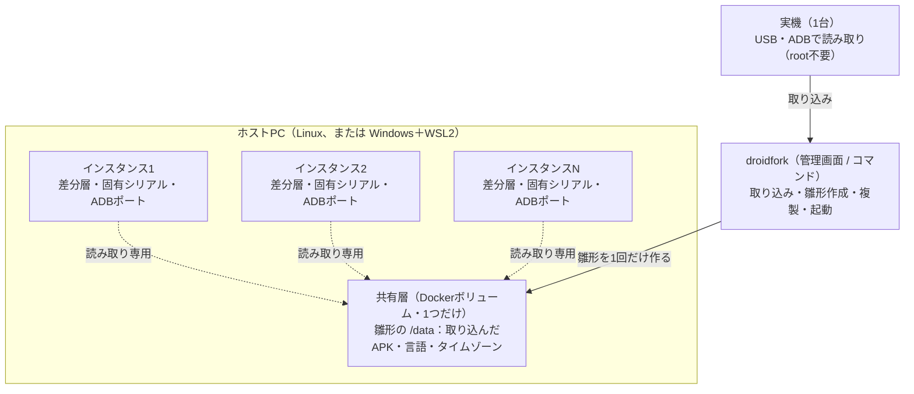

# DroidFork（仮）

手元のスマートフォン1台をUSBでつないで「雛形（テンプレート）」として取り込み、指定した台数ぶんの仮想Android端末をPC上で同時に起動するツールです。各台は1つの共有層（雛形）を読み取り専用で参照し、自分の差分だけを持つので、台数を増やしてもディスクの増分を最小に抑えられます。

| 項目 | 内容 |
| --- | --- |
| 入力 | 実機1台（USB／ADB接続、root不要）＋台数 N |
| 出力 | N台の仮想Android端末。ADB上でそれぞれ別の端末として並ぶ |
| 中核技術 | コンテナ型Android（[Redroid](https://github.com/remote-android/redroid-doc)）＋共有層＋インスタンスごとの差分層（overlayfs） |
| 対象ホスト | Linux（Ubuntu / Debian）、Windows 10/11（WSL2） |
| 操作 | ブラウザの管理画面、またはコマンド（`droidfork`） |

企画書の MVP・v1・v2 の機能をすべて実装しています。

| 段階 | 機能 | 状態 |
| --- | --- | --- |
| MVP | 取り込み・N台生成・起動停止、差分層によるリセット、ADB一覧 | ○ |
| v1 | Windows向けインストーラ（WSL2込み）、管理画面（GUI）、画面表示（scrcpy）、一括APK配布 | ○ |
| v2 | テンプレートの複数管理（複製・APKの追加/削除）、スナップショット、台ごとのCPU・メモリ上限、スケジュール起動 | ○ |

## 仕組み



1. **取り込み**: 実機から Android バージョン、画面解像度・DPI、言語・タイムゾーン、表示設定（文字サイズ・24時間表示）、ユーザーがインストールしたアプリのAPK（分割APKを含む）を読み取ります。
2. **雛形の作成**: 実機と同じバージョンの Redroid を、空のボリュームを `/data` にして1回だけ起動し、設定とAPKを適用します。最後に Android ID などの端末固有の値を取り除いて停止し、このボリュームを共有層として固定します。
3. **複製**: 台数ぶんの空の差分層、シリアル、MAC、ADBポートを割り当てます。ディスクはコピーしないので一瞬で終わります。
4. **起動**: 共有層を `/data-base` に読み取り専用で、差分層を `/data-diff` にマウントし、`androidboot.use_redroid_overlayfs=1` で起動します。書き込みは差分層にだけ入ります。
5. **リセット**: 差分層を作り直すだけで雛形の状態に戻ります。

## インストール

### Windows 10/11

リリースの `DroidFork-Setup-<版>.exe` を実行します。WSL2 の有効化、binder を組み込んだ WSL2 カーネル、専用の Linux 環境、Docker・adb・droidfork、実機をつなぐための usbipd-win まで自動で設定します。終わるとスタートメニューに「DroidFork」ができます。詳しくは [docs/windows.md](docs/windows.md) を見てください。

### Ubuntu / Debian

```sh
sudo ./install.sh                         # リリースの deb を取得して、binder・Docker まで設定する
# または
sudo apt install ./droidfork_<版>_all.deb  # deb だけ入れる（Docker・adb も一緒に入る）
droidfork doctor                          # 足りないものと対処方法を表示する
```

そのほかの Linux では、`pipx install droidfork-<版>-py3-none-any.whl` か、1ファイル版の `python3 droidfork-<版>.pyz` で動きます。配布物の一覧と作り方は [docs/packaging.md](docs/packaging.md) にあります。

ホストに必要なもの: Docker、カーネルの binder と overlayfs、adb、Python 3.10 以上（追加のライブラリは不要）。Ubuntu では `linux-modules-extra-$(uname -r)` に binder が入っています。ashmem が無いカーネルでは自動で memfd を使います。

## 使い方

### 3ステップで起動する

```sh
# 1. 実機をUSBでつなぎ、端末側で「USBデバッグ」を許可する
# 2. 取り込み → 雛形作成 → 5台複製 → 起動 をまとめて実行
droidfork up -n 5
# 3. 5台が別々の端末として並ぶ
adb devices
```

雛形の作成は初回だけ数分かかります（ベースイメージの取得と Android の初回起動）。2回目以降は `droidfork up -n 3 -t <テンプレート名>` で、既存の雛形から台数だけ追加できます。

### 管理画面

```sh
droidfork ui --open
```

ブラウザで、テンプレートの取り込み・作成、台数の追加、起動・停止・リセット・削除、画面表示、一括APK導入、スナップショット、スケジュール、識別子の確認、実測まで操作できます。Windows ではスタートメニューの「DroidFork」から開きます。

管理画面は `127.0.0.1` でだけ待ち受け、起動時に表示される URL のトークンがないと操作できません。

### 手順を分けて実行する

```sh
droidfork devices                          # 接続中の端末を確認
droidfork capture --name shop              # 実機から取り込む
droidfork template build shop              # 雛形を作る
droidfork template show shop               # アプリの導入結果・注記を確認
droidfork create shop -n 5                 # 5台を複製（一瞬）
droidfork start -t shop                    # 起動して完了を待つ
droidfork list
```

取り込むアプリは `--include 'com.example.*'` や `--exclude '*.game'` で絞れます。実機が手元にない場合は `droidfork template new lab --android 14 --locale ja-JP --apk app.apk` で雛形を定義できます。

### コマンド一覧

| コマンド | 内容 |
| --- | --- |
| `up -n N` | 取り込み → 雛形作成 → N台複製 → 起動 |
| `ui` | ブラウザの管理画面を起動する（`--open` でブラウザを開く） |
| `doctor` | ホスト環境を確認する（Docker・binder・overlayfs・adb・メモリ・KSM、WSL2 では usbipd-win） |
| `devices` | adb に接続された端末を一覧する（実機とDroidForkの各台を区別） |
| `capture` | 実機からアプリ構成と画面・地域設定を取り込む |
| `template list / show / build / new / rm` | テンプレートの管理 |
| `template clone <元> <新>` | テンプレートを複製する（版の管理） |
| `template add-apk / rm-apk` | テンプレートにアプリを足す・外す（作り直しが必要） |
| `create <テンプレート> -n N` | N台を複製する（`--scale` `--fps` `--cpus` `--memory`） |
| `list` | インスタンスの一覧（状態・ADBアドレス・シリアル・画面・上限・前回の起動時間） |
| `start / stop / restart` | 起動・停止（停止しても差分は残る） |
| `reset` | 差分を消して雛形の状態に戻す（シリアル・MAC・ポートは維持） |
| `rm` | 削除する（差分も消える） |
| `limit` | 台ごとのCPU・メモリ上限を表示・変更する（起動中の台にもすぐ反映） |
| `snapshot create / list / restore / rm` | 台の状態を保存して、あとで戻す |
| `schedule add / list / rm / enable / disable / install` | 決まった時刻に起動・停止・再起動・リセットする |
| `connect` | 起動中の各台を adb に接続し直す |
| `ids` | 各台のシリアル・Android ID・MAC を表示し、重複がないか調べる |
| `install <APK またはフォルダ>` | 起動中の全台へAPKを一括導入する（フォルダは分割APKとして扱う） |
| `screen <ID>` | scrcpy で画面を開く |
| `usb list / attach / detach` | WSL2: 実機を Windows から WSL へつなぐ（usbipd-win） |
| `logs <ID>` | コンテナのログを見る |
| `stats` | 1台あたりのディスク増分・メモリ使用量を実測する（`--json` で記録用） |
| `config` | 現在の設定を表示する |

対象の指定は `start shop-01 shop-02`（ID）、`-t shop`（テンプレート単位）、`--all`（全台）のいずれかです。`reset`・`rm`・`snapshot restore` は確認を求めます（`-y` で省略）。

### メモリを節約する

- `--scale 0.5`: 解像度とDPIを同じ比率で下げる（レイアウトは保ったまま）
- `--fps 15`: 画面の更新頻度を下げる
- `--memory 2g --cpus 1.5`: 1台あたりの上限を決める（`droidfork limit` であとから変えられる）
- 描画はソフトウェア描画（`gpu_mode: guest`）が既定です
- 設定 `"image_variant": "_64only"`: 32bit の仕組みを省いた軽量イメージを使う（Android 12 以降。32bit専用アプリは動きません）

```sh
droidfork create shop -n 10 --scale 0.5 --fps 15 --memory 2g
```

### スナップショット

台の今の状態（差分層）を保存し、あとで戻せます。ログインした状態を保存しておき、検証のたびにそこへ戻す、といった使い方ができます。

```sh
droidfork snapshot create shop-01 --name logged-in --note "ログイン済み"
droidfork snapshot restore logged-in              # 保存元の shop-01 に戻す
droidfork snapshot restore logged-in shop-02 -y   # 同じテンプレートの別の台へ広げる
```

別の台へ戻すときは、アプリのデータは引き継ぎますが、Android ID の元になる値は消して、その台の初回起動で作り直させます（識別子を複製しないため）。複製には `cp -a` を使い、overlayfs の削除の印や拡張属性もそのまま写します。

### スケジュール起動

```sh
droidfork schedule add --at 09:00 --action start --days weekdays -t shop
droidfork schedule add --at 18:30 --action stop --all
droidfork schedule install      # 1分ごとに予定を確認するタイマーを登録する（systemd）
```

deb で入れた場合は `sudo systemctl enable --now droidfork-scheduler@$USER.timer` でも有効にできます。Windows 版は設定済みです。PC がスリープしていて予定の時刻を過ぎた場合、15分以内なら実行します。

## 実機から取り込めるもの・取り込めないもの

| 項目 | 可否 | 補足 |
| --- | --- | --- |
| 画面解像度・DPI | ○ | 実機で表示サイズを変えている場合はその値を使う |
| 言語・タイムゾーン・文字サイズ・24時間表示 | ○ | 雛形に書き込む |
| ユーザーがインストールしたアプリ | ○ | APKを取得して雛形に導入。分割APKはまとめて導入 |
| Androidバージョン | △ | 同じ番号のイメージを選ぶ。提供範囲（8.1〜16）外は最も近いものを使い、注記を残す |
| ARM向けアプリ（x86のPC） | △ | イメージの翻訳機能に依存。導入に失敗したアプリは `template show` に理由と対処を表示 |
| アプリ内データ・ログイン状態 | × | root なしでは取り出せないため対象外（取り込み後に操作してスナップショットで保存はできる） |
| メーカー独自アプリ・プリインアプリ | × | 汎用イメージには移植しない |
| IMEI・シリアルなどの固有識別子 | × | 意図的に取り込まない（次節） |

決済・銀行アプリや一部のゲームなど、Play Integrity で端末を判定するアプリは動かない前提です。Google Play 開発者サービスは同梱しません。

## 端末識別子の扱い

各台は「仮想端末として正直に名乗る別端末」にします。

| 識別子 | 扱い |
| --- | --- |
| ADBシリアル | 台ごとに別のポート（`127.0.0.1:15555` から順に割り当て） |
| 端末シリアル（`ro.serialno`） | 台ごとに新規生成（例: `DF0003K7Q2ZP` ＝ 連番＋ランダム） |
| Android ID | 雛形には残さず、各台の初回起動で Android 自身が生成する（リセットや別の台への復元でも作り直される） |
| MACアドレス | 台ごとに新規生成（ローカル管理アドレス `02:44:46:xx:xx:xx`） |
| 機種名・メーカー名 | `DroidFork-Virtual` / `DroidFork` で固定。実機の機種名はテンプレートの表示用メモにだけ残す |
| IMEI・実機のシリアル・広告ID | 取り込まない、設定もしない |

雛形の作成時には、Android ID の元になる値（設定の `android_id` と、アプリごとの Android ID の鍵 `settings_ssaid.xml`）と乱数の種を取り除きます。起動後に `droidfork ids`（管理画面の「識別子を確認」）を実行すると、各台の値に重複がないかを確かめられます。

端末フィンガープリントの偽装、root 状態の隠蔽、Play Integrity などの端末判定の回避は実装しません。他社サービスの利用規約で禁じられた多重アカウント運用、キャンペーンやポイントの重複取得にも使わないでください。

## 安全のための既定値

- ADB は `127.0.0.1` でだけ待ち受けます。ADB を外部ネットワークに出すと端末やホストを乗っ取られるおそれがあるため、`adb_bind` を変える場合は `doctor` が注意を表示します。
- 管理画面も `127.0.0.1` でだけ待ち受け、トークンと Host ヘッダーを確かめます。
- 共有層は読み取り専用でマウントします。インスタンスがあるテンプレートは作り直せません（作り直すと各台の差分と食い違うため）。変更したいときは `template clone` で別のテンプレートにします。
- 雛形の作成時だけ、設定の書き込みのために root の adb シェル（`ro.secure=0`）を使います。各インスタンスは通常の状態で起動します。

## PoC（実測）

```sh
droidfork stats          # 共有部分・各台の差分・メモリ・丸ごとコピーとの比較
droidfork stats --json > poc-10台.json
```

手順と記録の仕方は [docs/poc.md](docs/poc.md) にまとめています。

## 設定

`~/.local/share/droidfork/config.json`（保存先は `--home` か環境変数 `DROIDFORK_HOME` で変えられます）に、変えたい項目だけを書きます。

| 項目 | 既定値 | 内容 |
| --- | --- | --- |
| `adb_port_base` / `adb_port_count` | 15555 / 1000 | ADBポートの割り当て範囲（5555〜5585 は adb がエミュレータとして自動検出するため避けています） |
| `adb_bind` | `127.0.0.1` | ADBの待ち受けアドレス |
| `image_repo` / `image_variant` | `redroid/redroid` / `""` | ベースイメージ（`<repo>:<バージョン><variant>-latest`） |
| `gpu_mode` | `guest` | `guest`（ソフト描画）/ `host` / `auto` |
| `fps` | 30 | 画面の更新頻度 |
| `use_memfd` | `auto` | `/dev/ashmem` が無ければ memfd を使う |
| `base_readonly` | `true` | 共有層を読み取り専用でマウントする |
| `boot_timeout` / `template_boot_timeout` | 300 / 900 | 起動完了を待つ秒数 |
| `manufacturer` / `model` | `DroidFork` / `DroidFork-Virtual` | 各台が名乗るメーカー名・機種名（空白不可） |
| `dns` | `[]` | 各台が使うDNS（空なら Redroid の既定） |
| `ui_port` | 8765 | 管理画面のポート |
| `helper_image` | `debian:bookworm-slim` | スナップショットの複製に使うイメージ |
| `adb` / `docker` / `scrcpy` / `usbipd` | コマンド名 | 使うコマンドのパス（環境変数 `DROIDFORK_ADB` などでも指定可） |

## データの置き場所

| もの | 場所 |
| --- | --- |
| テンプレートの情報と取り込んだAPK | `~/.local/share/droidfork/templates/<名前>/` |
| インスタンスの割り当て（ポート・シリアル・MAC・上限） | `~/.local/share/droidfork/instances/<ID>.json` |
| スナップショットの情報 / 予定 | `~/.local/share/droidfork/snapshots/`、`schedules.json` |
| 雛形の共有層 | Docker ボリューム `droidfork-base-<テンプレート名>` |
| 各台の差分層 | Docker ボリューム `droidfork-diff-<ID>` |
| スナップショット | Docker ボリューム `droidfork-snap-<名前>` |
| 実行中の各台 | Docker コンテナ `droidfork-<ID>` |

## 動作確認の状況と制限事項

確認できていること:

- 偽の adb・docker・実機・Redroid を使ったテスト（Python 3.10〜3.13）
- 本物の Docker 29 で、読み取り専用の共有層と各台の差分層を overlayfs で重ねる仕組み、スナップショットの複製（削除の印・拡張属性を含む）、上限の変更（`docker update`）
- 管理画面をブラウザ（Chromium）で表示・操作（パソコン・スマホ幅、ライト・ダーク）
- deb を Ubuntu 24.04 に入れて動くこと
- binder 入りの WSL2 カーネルのビルドと、QEMU での起動（binderfs と overlayfs）

まだ確認できていないこと:

- **実機と Redroid の組み合わせでの通しの動作。** 開発環境には binder 対応カーネルで動く Docker と実機が無かったため、PoC で確認してください。
- **Windows の実機での導入。** インストーラのビルドとスクリプトのテストは GitHub Actions の Windows で行いますが、WSL2 の有効化から起動までの通しは Windows で確認してください（[docs/windows.md](docs/windows.md)）。
- Redroid の README には、`use_redroid_overlayfs` を使うときに `/data-base` を読み取り専用にしてよいかが書かれていません。インスタンスが起動しない場合は、設定 `"base_readonly": false` を試してください。

そのほかの制限:

- 雛形の作成には、userdebug ビルドの Redroid イメージ（公式イメージ）が必要です。
- 一度に作成できるのは 200 台までです。

## 開発

```sh
python3 -m unittest -v          # テスト
packaging/build.sh              # 配布物を dist/ に作る
```

外部ライブラリは使っていません。Redroid 固有の知識（起動パラメータ・マウント先・命名）は `droidfork/redroid.py` に集めてあり、上流の仕様が変わったときはここで吸収します。

| ファイル | 役割 |
| --- | --- |
| `droidfork/cli.py` | コマンドライン |
| `droidfork/ui.py` / `ui.html` | 管理画面（HTTP サーバーと画面） |
| `droidfork/capture.py` | 実機からの取り込み、テンプレートの複製・APKの追加 |
| `droidfork/template.py` | 雛形の作成・封印・削除 |
| `droidfork/instances.py` | 複製・起動・停止・リセット・削除・上限・一括導入・画面表示 |
| `droidfork/snapshots.py` | スナップショット |
| `droidfork/schedule.py` | スケジュール起動 |
| `droidfork/usb.py` | WSL2 で実機をつなぐ（usbipd-win） |
| `droidfork/redroid.py` | Redroid の起動パラメータと docker run の組み立て |
| `droidfork/identity.py` | シリアル・MACの生成と機種名 |
| `droidfork/images.py` | Android バージョン → ベースイメージの選択 |
| `droidfork/stats.py` | 実測（ディスク増分・メモリ） |
| `droidfork/hostcheck.py` | ホスト環境の確認 |
| `packaging/` | Linux 向けの配布物（deb・pyz・wheel）とインストールスクリプト |
| `windows/` | Windows インストーラ、WSL2 の設定スクリプト、binder 入りカーネルのビルド |
| `tests/` | テスト（`fakes.py` は偽の adb・docker・実機・Redroid） |

## ライセンス

このリポジトリのコードは GPL-3.0 です（`LICENSE`）。Redroid のイメージは同梱せず、実行時に Docker Hub から取得します。Redroid 本体は Apache License 2.0、カーネルモジュールは GPL v2 で、同梱されているサードパーティ部品は個別に確認が必要です。Windows 版で配る WSL2 カーネルは Microsoft の [WSL2-Linux-Kernel](https://github.com/microsoft/WSL2-Linux-Kernel)（GPL v2）に設定を加えてビルドしたもので、ソースはそのリポジトリのタグと `windows/kernel/` の設定で再現できます。
